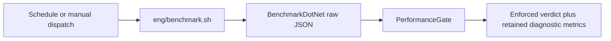

# Performance and Memory Evidence

This runbook is the operator entry point for provider benchmarks. The current
design has one measurement owner and one decision owner:



Performance evidence is independent of release qualification. The release
candidate neither invokes benchmarks nor consumes their artifacts.

## Hardware-Independent Enforcement

Local and hosted runs use the same allocation/resource enforcement policy.
`DOKA_BENCHMARK_EVALUATION` defaults to `allocations-only`; `full` remains an
accepted compatibility spelling and resolves to the same policy. Unknown
values are rejected.

| Signal | Local and hosted execution |
| --- | --- |
| Allocation bytes and allocation ratios | Enforced |
| Correctness and explicit bounded-resource/cleanup invariants | Enforced |
| Median/p95/p99 time and timing ratios | Diagnostic |
| Gen2 collection frequency | Diagnostic |
| Working-set/managed-heap soak growth and throughput retention | Diagnostic |
| CPU-headroom admission before measurement | Not used |

Every run requires complete, valid raw evidence and successful execution.
Hardware-sensitive metrics remain measured, validated and retained. Their
threshold crossings are diagnostics, including when legacy callers explicitly
request `full`. No attempt selection or automatic budget relaxation is used.
Allocation regressions and real resource-ownership/cleanup failures still fail.
A genuine infrastructure outage or execution failure can also fail a run.

## Choose the Right Document

| Task | Canonical owner |
| --- | --- |
| Run a target or diagnose a failure | This runbook |
| Interpret profiles, raw evidence, gate results, or soak | [Performance Evidence Reference](performance-evidence-reference.md) |
| Understand why paired comparisons were retired | [Paired Performance Methodology](paired-performance-methodology.md) |
| Review image and budget changes | [Performance Baseline Operations](performance-baseline-operations.md) |
| Investigate enumeration costs with complete offline methods | [Enumeration Performance Measurements](enumeration-performance.md) |

## Query and direct-write feature diagnostics

The feature diagnostics introduced with 10.7.0 reuse the existing benchmark
runner. This 11.0.0 / .NET 11 line pins BenchmarkDotNet `0.16.0-preview.2` in
`Directory.Packages.props`; the .NET 10 line uses `0.15.8`. The temporary
preview is benchmark/test-only, as described in the
[runner compatibility policy](performance-baseline-operations.md#net-11-benchmark-tooling).
Historical .NET 10 measurements retain their original runtime and tool identities.

These diagnostics introduce no timing thresholds or new performance-contract
rows. The normal profiles, allocation ceilings and hosted enforcement remain
unchanged. Select these additional families explicitly when investigating the
features:

| Family | Measured work and setup controls |
| --- | --- |
| `QueryEnumerationBenchmark`, `compile-cte-*` | Complete uncached EF compilation for three references, six dependent definitions and a fifty-field model pruned to four shared columns. Setup verifies SQL shape and a closed connection. |
| `QueryEnumerationBenchmark`, `compile-recursive-numeric` | Complete bounded recursive compilation, including its depth control and ordered payload. |
| `QueryEnumerationBenchmark`, `compile-window-*` | Complete fluent-window, global indexed and grouped indexed compilation, with independent SQL-shape controls. |
| `DirectWriteBenchmark` | Complete public UPSERT/INSERT SELECT operations for 1 row/3 mapped columns and 14,000 rows/50 mapped columns. Setup verifies every native value, affected count, data-command count, batching and transaction behavior. |

Run a selected family from the Release benchmark output, for example:

```bash
dotnet artifacts/bin/Doka.EntityFrameworkCore.MySql.Benchmarks/release/Doka.EntityFrameworkCore.MySql.Benchmarks.dll \
  --filter '*QueryEnumerationBenchmark*' --artifacts <fresh-results-directory>
```

For `DirectWriteBenchmark`, first start a qualified native target and set
`DOKA_BENCHMARK_TARGET` and `DOKA_BENCHMARK_DATABASE_PORT` to its contract target
and mapped port. Select `--filter '*DirectWriteBenchmark*'`. The fixture creates
and removes only its uniquely named database. Inputs and schema setup stay
outside measurement; public binding, batching, native execution and cleanup
remain measured. INSERT SELECT uses server-side source rows. Target clearing
occurs outside each measured operation with one invocation per iteration.

Retain the exact runtime, engine, model width and complete raw reports when
comparing revisions. Timing and allocation observations from one host or patch
do not establish a general application speedup. SQL/value/control failures
remain failures regardless of timing.

## Prerequisites

- the repository-pinned .NET SDK;
- Docker with Compose support;
- `jq`; and
- one exact image declared in `benchmarks/performance-contract.json`.

Python is not part of benchmark execution or evaluation.

## Run One Target

Start the selected container, run the benchmark, evaluate it, and remove the
container:

```bash
DOKA_BENCHMARK_TARGET=mysql84 \
DOKA_BENCHMARK_PROFILE=smoke \
DOKA_BENCHMARK_PORT=0 \
./eng/benchmark.sh --up-run-down
```

Use an already running contract-compatible target:

```bash
DOKA_BENCHMARK_TARGET=mariadb118 \
DOKA_BENCHMARK_PROFILE=scorecard \
./eng/benchmark.sh --test-only
```

Use a unique `DOKA_BENCHMARK_RUN_ID` for every run. The wrapper rejects a
non-empty run directory rather than mixing old and new measurements.

Local execution already uses the same policy as GitHub Actions. Legacy
`DOKA_BENCHMARK_EVALUATION=full` invocations remain accepted without enabling
timing, throughput or machine-load rejection.

The wrapper performs these steps exactly once:

1. Resolve and verify the target container and exact image.
2. Build the benchmark project.
3. Run the selected provider workloads and same-run controls through
   BenchmarkDotNet.
4. Run the six soak scenarios when the profile requires them.
5. Validate all raw reports, enforce the resource budgets/invariants and report
   hardware-sensitive diagnostic threshold violations separately.

The monthly and manual workflow uses one matrix job per required target. It
does not run after every merge and it has no retry, attempt-selection,
confirmation, receipt, or baseline-promotion state machine.

## Failure Triage

### Exit code 78: invalid evidence

The measurement cannot support a performance decision. Typical causes are a
missing or duplicate workload, non-finite raw values, a failed
BenchmarkDotNet report, a target mismatch, an attached debugger, mixed host
identity, missing required soak evidence, or an infrastructure failure.

Fix the cause and rerun the workflow job. Do not convert invalid evidence into
a provider regression.

### Exit code 1: regression

The evidence is complete, but at least one **enforced** checked-in maximum or
minimum was violated. This means an allocation or explicit correctness/resource
invariant; elapsed-time, collection-frequency and process-memory-growth threshold
crossings remain diagnostic both locally and in GitHub Actions. Investigate the named workload/invariant before
changing a budget; no workflow promotes budgets automatically.

### Competing host load

Record competing work when interpreting time, throughput and process-memory
observations. Comparable controlled-host measurements can help an investigation,
but no CPU-headroom admission or speed threshold determines the run's verdict.

### BenchmarkDotNet failure

Inspect the full JSON reports and console log. BenchmarkDotNet owns warmup,
iterations, measurement, and allocation statistics. A missing result is
invalid evidence, not a zero or an ignored workload.

### Soak failure

Use the scenario ID to locate the resource owner. Bounded HiLo cache, returned
pooled buffers, connections and migration-lock cleanup remain enforced in every
mode. Working-set/managed-heap growth and concurrent throughput retention are
diagnostic on local and hosted runners. Every required scenario and finite
metric is still mandatory: missing or invalid
soak evidence fails rather than becoming a diagnostic pass.

The raw soak report retains the original threshold-based `Success` fields so
the evaluator can detect contradictory evidence. The standalone soak exits `1`
for resource or execution failures; diagnostic-only threshold crossings do not
reject its process. The wrapper passes the complete report to the combined
evaluator. Crashes, missing reports, non-finite observations and unexpected exit
codes remain failures.

## Evidence Locations

Raw reports are written below:

```text
artifacts/benchmarks/<target>/reports/<run-id>/
```

Workflow diagnostics are deliberately outside that directory:

```text
artifacts/benchmarks/<target>/diagnostics/<run-id>.log
```

This separation prevents logging from violating the benchmark runner's fresh
directory precondition.
