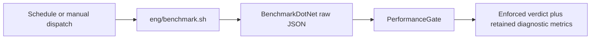

# Performance and Memory Evidence

This runbook is the operator entry point for provider benchmarks. The current
design has one measurement owner and one decision owner:



Performance evidence is independent of release qualification. The release
candidate neither invokes benchmarks nor consumes their artifacts.

## Hosted Versus Local Enforcement

`DOKA_BENCHMARK_EVALUATION` accepts exactly `full` or `allocations-only`.
An unset local run defaults to `full`. GitHub Actions always resolves to
`allocations-only`, even if `full` is requested; unknown values are rejected.

| Signal | GitHub Actions / `allocations-only` | Local `full` |
| --- | --- | --- |
| Allocation bytes and allocation ratios | Enforced | Enforced |
| Correctness and explicit bounded-resource/cleanup invariants | Enforced | Enforced |
| Median/p95/p99 time and timing ratios | Diagnostic | Enforced |
| Gen2 collection frequency | Diagnostic | Enforced |
| Working-set/managed-heap soak growth and throughput retention | Diagnostic | Enforced |
| CPU-headroom admission before measurement | Not used | Required |

All modes require complete, valid raw evidence and successful execution.
Hardware-sensitive metrics remain measured, validated and retained; only
their threshold violations stop contributing to the hosted regression verdict.
No `continue-on-error`, attempt selection or automatic budget relaxation is
used. Allocation regressions and real resource-ownership/cleanup failures still
fail. A genuine infrastructure outage or timeout can still fail a hosted run;
this policy does not promise hardware can never prevent execution.

## Choose the Right Document

| Task | Canonical owner |
| --- | --- |
| Run a target or diagnose a failure | This runbook |
| Interpret profiles, raw evidence, gate results, or soak | [Performance Evidence Reference](performance-evidence-reference.md) |
| Understand why paired comparisons were retired | [Paired Performance Methodology](paired-performance-methodology.md) |
| Review image and budget changes | [Performance Baseline Operations](performance-baseline-operations.md) |
| Investigate enumeration costs with complete offline methods | [Enumeration Performance Measurements](enumeration-performance.md) |

## Prerequisites

- the repository-pinned .NET SDK;
- Docker with Compose support;
- `jq`; and
- one exact image declared in `benchmarks/performance-contract.json`.

Python is not part of benchmark execution or evaluation.

## Run One Target

Start the selected container, run the benchmark, evaluate it, and remove the
container:

```bash
DOKA_BENCHMARK_TARGET=mysql84 \
DOKA_BENCHMARK_PROFILE=smoke \
DOKA_BENCHMARK_PORT=0 \
./eng/benchmark.sh --up-run-down
```

Use an already running contract-compatible target:

```bash
DOKA_BENCHMARK_TARGET=mariadb118 \
DOKA_BENCHMARK_PROFILE=scorecard \
./eng/benchmark.sh --test-only
```

Use a unique `DOKA_BENCHMARK_RUN_ID` for every run. The wrapper rejects a
non-empty run directory rather than mixing old and new measurements.

To reproduce hosted enforcement locally, prefix the same command with
`DOKA_BENCHMARK_EVALUATION=allocations-only`. Use local `full` only on a
controlled host when a timing verdict is useful. Setting `full` inside GitHub
Actions does not override the hosted policy.

The wrapper performs these steps exactly once:

1. Resolve and verify the target container and exact image.
2. Build the benchmark project.
3. In local full mode only, reject a contended host before measurement.
4. Run the selected provider workloads and same-run controls through
   BenchmarkDotNet.
5. Run the six soak scenarios when the profile requires them.
6. Validate all raw reports, enforce the selected budgets/invariants and report
   hardware-sensitive diagnostic threshold violations separately.

The monthly and manual workflow uses one matrix job per required target. It
does not run after every merge and it has no retry, attempt-selection,
confirmation, receipt, or baseline-promotion state machine.

## Failure Triage

### Exit code 78: invalid evidence

The measurement cannot support a performance decision. Typical causes are a
missing or duplicate workload, non-finite raw values, a failed
BenchmarkDotNet report, a target mismatch, an attached debugger, mixed host
identity, missing required soak evidence, or an infrastructure failure.

Fix the cause and rerun the workflow job. Do not convert invalid evidence into
a provider regression.

### Exit code 1: regression

The evidence is complete, but at least one **enforced** checked-in maximum or
minimum was violated. In GitHub Actions this means an allocation or explicit
correctness/resource invariant, not merely an elapsed-time, collection-frequency
or process-memory-growth threshold. Local full mode additionally enforces those
hardware-sensitive thresholds. Investigate the named workload/invariant before
changing a budget; no workflow promotes budgets automatically.

### Host admission failure

This admission check applies only to local full mode. Wait for competing work
to finish or move that run to a representative host. The Shell preflight samples
CPU utilization only before BenchmarkDotNet starts and owns no retry state.
GitHub Actions skips CPU-headroom admission; it does not waive target, execution
or evidence checks.

### BenchmarkDotNet failure

Inspect the full JSON reports and console log. BenchmarkDotNet owns warmup,
iterations, measurement, and allocation statistics. A missing result is
invalid evidence, not a zero or an ignored workload.

### Soak failure

Use the scenario ID to locate the resource owner. Bounded HiLo cache, returned
pooled buffers, connections and migration-lock cleanup remain enforced in every
mode. Working-set/managed-heap growth and concurrent throughput retention are
diagnostic on hosted runners and enforced only in local full mode. Every
required scenario and finite metric is still mandatory: missing or invalid
soak evidence fails rather than becoming a diagnostic pass.

The raw soak process can exit `1` for a measured threshold violation. The wrapper
passes its complete report to the one combined evaluator, which classifies
that threshold under the selected mode. This does not ignore crashes, missing
reports or unexpected exit codes; those remain failures.

## Evidence Locations

Raw reports are written below:

```text
artifacts/benchmarks/<target>/reports/<run-id>/
```

Workflow diagnostics are deliberately outside that directory:

```text
artifacts/benchmarks/<target>/diagnostics/<run-id>.log
```

This separation prevents logging from violating the benchmark runner's fresh
directory precondition.
