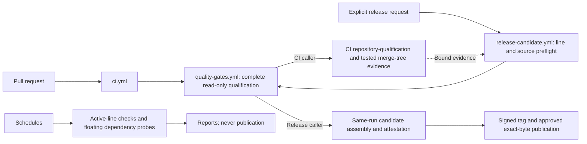
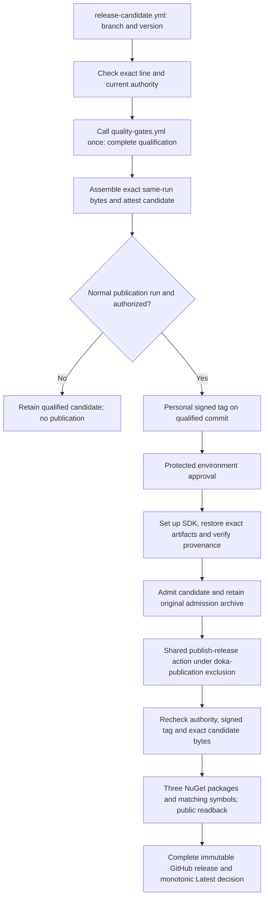

# Workflow Overview

Doka has three delivery flows. Pull requests and explicit release candidates
use one complete qualification definition; schedules also detect upstream
drift. The shared qualifier grants no publication authority. A green PR does
not mean a signed release candidate has been assembled or published.

## 1. Pull Requests: Verify the Proposed Change

[`ci.yml`](../../.github/workflows/ci.yml) calls the same
[`quality-gates.yml`](../../.github/workflows/quality-gates.yml) used by release
candidates. The reusable workflow owns the complete product graph:

| Job | Responsibility |
| --- | --- |
| `quality-gates` | Repository, formatting, documentation and engineering contracts. |
| `repo-tests` | Release-tool tests plus provider unit and functional tests. |
| `spec-test-suite` | EF Core specification conformance on all six supported engines. |
| `integration` | Full live integration/configuration/failure coverage and examples. |
| `foundation` | Exactly three package/symbol pairs; isolated real-package consumers and runtime readback. |
| `engine-contracts` | Migration deployment, runtime trim/cache NativeAOT, qualified EF Core and driver patch matrices. |
| `sbom` | SBOM from the exact package-stage dependency assets. |
| `coverage-gate` | Merge coverage evidence and enforce the reviewed thresholds. |
| `required` | Fail closed unless every required product result succeeds. |

The caller-side `repository-qualification` check keeps its stable name and
retains the exact tested PR merge-tree identity after shared qualification
succeeds. Package consumers and SBOM are ordinary PR gates. The qualifier has
no publisher environment, publishing secrets, OIDC, attestation or repository-write
permission. Its explicit version and optional frozen authorization artifact
inputs preserve the distinction between PR checks and admitted candidate stages.
Each branch supplies its own SDK, framework, test runner and applicable reviewed
dependency policy, including when these checks transfer to .NET 11.

The branch's reviewed release evidence policy declares its engine stages.
`qualify-engine.sh --list` supplies the engine matrix; `--all-stages` adds package
and SBOM for candidate artifact restoration and final receipt verification. A
missing implementation for a declared gate fails qualification. A preview
line's policy may omit the stable EF patch-range gate; file absence cannot
silently remove a required gate.

Specification execution follows the branch's native
[`global.json` test runner selection](https://learn.microsoft.com/en-us/dotnet/core/tools/global-json#test).
The shared helper validates that selection before setup and uses the branch's
runner-specific filtering, coverage and TRX protocol. This source contract does
not establish that the new helper has executed on another framework line.

[`dependency-review.yml`](../../.github/workflows/dependency-review.yml) is an
independent PR workflow for dependency changes; it is not another job hidden
inside `ci.yml`. Platform-owned dependency submission and code-scanning checks
can also appear independently. None of these checks publishes packages or
grants a feature branch release authority.

[`scorecard.yml`](../../.github/workflows/scorecard.yml) independently assesses
repository-wide supply-chain practices. It is not framework qualification or
publication authority, and is not duplicated for each maintained platform line.

### Hosted Runner Baseline

All checked-in hosted jobs explicitly use `ubuntu-26.04` on x64, including
release, security and benchmark jobs. The benchmark runner identity records
the same image line. The OS label is deliberate; it does not freeze every
tool or patch in GitHub's rolling image. `setup-dotnet` still selects the exact
SDK in `global.json`, independent of the image's preinstalled SDKs. This CI
host change does not raise application runtime or operating-system requirements.

Ubuntu 26.04 is generally available and supported by .NET 10. See the
[GitHub image announcement](https://github.com/actions/runner-images/issues/14747),
[image inventory](https://github.com/actions/runner-images/blob/main/images/ubuntu/Ubuntu2604-Readme.md)
and [.NET 10 support table](https://github.com/dotnet/core/blob/main/release-notes/10.0/supported-os.md).

The pinned Actionlint 1.7.12 predates that label. Its
[native label configuration](https://github.com/rhysd/actionlint/blob/v1.7.12/docs/config.md)
registers only `ubuntu-26.04` in `.github/actionlint.yaml`. Despite the setting's
`self-hosted-runner` name, it only extends the linter catalogue; GitHub still
selects its hosted image. Unknown labels remain errors. Remove this entry when
the pinned linter recognizes the label itself. Synthetic linter-only jobs and
detached test fixtures are not hosted jobs and may retain older sample labels.

## 2. Schedules: Detect Drift Without Publishing

| Cadence | Workflow | Purpose |
| --- | --- | --- |
| Daily | [`security-audit.yml`](../../.github/workflows/security-audit.yml) | Branch-local dependency vulnerability audit. |
| Weekly | [`ci.yml`](../../.github/workflows/ci.yml) | Migration-deployment checks and independent floating EF Core/MySqlConnector drift probes. |
| Weekly | [`container-matrix.yml`](../../.github/workflows/container-matrix.yml) | Full supported database/configuration matrix. |
| Monthly | [`benchmark.yml`](../../.github/workflows/benchmark.yml) | Performance measurements and allocation/resource regression checks. |

These workflows also support explicit manual execution. A schedule runs the
default line once and dispatches each other **active** line's own workflow,
binding its expected commit and awaiting its actual result. It does not run
main's .NET 10 commands around a .NET 11 checkout. Ordinary manual feature CI
remains non-publishing even when no preview release line is active.

Normal manual CI calls the shared qualifier once. Standalone migration and
floating dependency jobs run on schedules or an explicit `maintenance=true`
dispatch, avoiding a second copy during normal qualification. Floating probes
can expose a newly published upstream patch before its exact contracts have
been admitted; ordinary qualification retains the reviewed dependency recipe.

### Benchmark Failures Versus Hardware Diagnostics

GitHub Actions always uses `DOKA_BENCHMARK_EVALUATION=allocations-only`:
allocation ceilings/ratios, correctness and explicit resource-ownership
invariants remain enforced. Median/p95/p99 time, timing ratios, Gen2 frequency,
working-set/managed-heap growth and throughput retention remain recorded and
validated, but their threshold violations are **diagnostics**, not hosted
regressions. CPU-headroom admission is local full-mode only. A slower or busier
CPU is therefore not itself a timing-budget reason for a red hosted benchmark.

This is not `continue-on-error`: failed execution, invalid or incomplete
evidence, allocation regressions, and real bounded-resource/cleanup failures
still fail. Hardware can still cause a genuine timeout or infrastructure
outage. All produced raw reports and diagnostics are retained for diagnosis.
Local runs default to `full`, which can enforce timing thresholds on a
controlled host; `GITHUB_ACTIONS=true` cannot opt into full enforcement.
See [Performance and Memory Evidence](performance-evidence.md).

## 3. Explicit Releases: Qualify Once, Then Publish Approved Bytes

The single entry is
[`release-candidate.yml`](../../.github/workflows/release-candidate.yml).
Select its authorized branch and canonical version; a `-rc.N` suffix selects
an RC, without a separate RC flag. Its normal `qualification_only=false`
default qualifies once, then uses the shared
[`publish-release` action](../../.github/actions/publish-release/action.yml)
after the existing personal signed tag and protected approval. Setting
`qualification_only=true` retains preparation evidence without entering a
publisher environment or requesting publication credentials.

Preflight imports the tree-exact PR qualification and checks release-line
authority before the candidate calls the common qualifier. Both callers execute
the complete reversible quality, test, integration, deployment, runtime,
dependency, package-consumer, SBOM and coverage graph. Candidate stages retain
same-run `release-stage-<stage>-attempt-N` artifacts, checkpoint ownership and
digest verification. The current main/10 assembly still requires its six stage
receipts; they are distinct from the complete product job graph. Assembly does
not repack qualified bytes. Attestation remains a separate release-only job.

EF Core qualification records the floor graph and fully exercises the highest
exact patch admitted to the branch's reviewed baseline; the driver matrix uses
its reviewed floor/latest recipe. Scheduled floating probes detect new upstream
drift independently. Benchmarks remain independent engineering diagnostics:
qualification never invokes them or consumes their artifacts, and hardware-dependent
timing, CPU or working-set thresholds are not qualifier gates.

All authorized lines use the existing `nuget` environment and the same workflow.
The single-maintainer approval arrangement and administrator bypass remain
unchanged; neither is replaced by a new publisher environment or migration. The approved
`maintenance/10.x` and `preview/11.x` names are initially **inactive**;
`feature/dotnet-11` remains unchanged. No branch, environment, NuGet binding or
package publication is created by this documentation.

Preparation, admission upload and publication run under the same existing job
lock and protected approval. Their separate timeline steps let the ordinary retry
distinguish an early download failure from a possibly frozen or published
candidate. See [failed publication and retry](release-lines.md#failed-publication-and-retry).

### Line Setup Is Separate From Ordinary Releases

An ordinary release or retry needs no manual inventory, copied digests or policy
PR. A new line needs its own reviewed toolchain/PR evidence and separately
approved branch protections, exact deployment grant and policy activation.
Prepared qualification requests no publisher environment or credentials.
Complete affected publication before disabling or reassigning its line; the
shared queue serializes publishers, not policy edits or administrator actions.
There is no framework-transition inventory/report or new credential generation.
See [Prepare or activate a line](release-lines.md#prepare-or-activate-a-line).

The [release-line procedure](release-lines.md) owns preparation, current versus
frozen authority, activation, ordinary exact-byte retry, Latest and
support/backport rules. The [publication runbook](release-publication.md) owns
the current operator sequence; this overview is a map, not a bypass.
