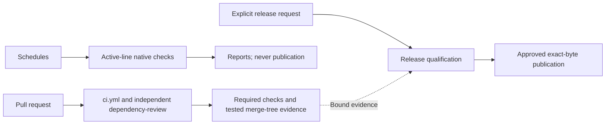
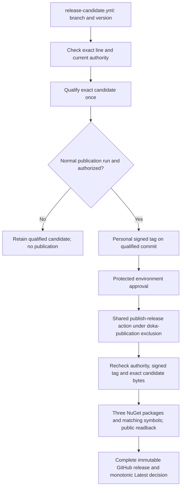

# Workflow Overview

Doka has three independent delivery flows. Pull-request checks decide whether
a change may merge; scheduled checks detect drift; an explicit release run
qualifies and publishes a chosen package version. A green result in one flow
does not imply the other two have run.

## 1. Pull Requests: Verify the Proposed Change

[`ci.yml`](../../.github/workflows/ci.yml) runs these product checks:

| Job | Responsibility |
| --- | --- |
| `quality-gates` | Repository, formatting, documentation and engineering contracts. |
| `repo-tests` | Release-tool tests plus provider unit and functional tests. |
| `spec-test-suite` | EF Core specification conformance on the selected engine matrix. |
| `integration-smoke` | Representative live integration and runtime-posture verification. |
| `coverage-gate` | Merge coverage evidence and enforce the reviewed thresholds. |
| `repository-qualification` | Require the product checks above and retain the exact tested PR merge-tree identity. |

[`dependency-review.yml`](../../.github/workflows/dependency-review.yml) is an
independent PR workflow for dependency changes; it is not another job hidden
inside `ci.yml`. Platform-owned dependency submission and code-scanning checks
can also appear independently. None of these checks publishes packages or
grants a feature branch release authority.

[`scorecard.yml`](../../.github/workflows/scorecard.yml) independently assesses
repository-wide supply-chain practices. It is not framework qualification or
publication authority, and is not duplicated for each maintained platform line.

## 2. Schedules: Detect Drift Without Publishing

| Cadence | Workflow | Purpose |
| --- | --- | --- |
| Daily | [`security-audit.yml`](../../.github/workflows/security-audit.yml) | Branch-local dependency vulnerability audit. |
| Weekly | [`ci.yml`](../../.github/workflows/ci.yml) | Migration-deployment and admitted EF Core/MySqlConnector patch-matrix checks. |
| Weekly | [`container-matrix.yml`](../../.github/workflows/container-matrix.yml) | Full supported database/configuration matrix. |
| Monthly | [`benchmark.yml`](../../.github/workflows/benchmark.yml) | Performance measurements and allocation/resource regression checks. |

These workflows also support explicit manual execution. A schedule runs the
default line once and dispatches each other **active** line's own workflow,
binding its expected commit and awaiting its actual result. It does not run
main's .NET 10 commands around a .NET 11 checkout. Ordinary manual feature CI
remains non-publishing even when no preview release line is active.

### Benchmark Failures Versus Hardware Diagnostics

GitHub Actions always uses `DOKA_BENCHMARK_EVALUATION=allocations-only`:
allocation ceilings/ratios, correctness and explicit resource-ownership
invariants remain enforced. Median/p95/p99 time, timing ratios, Gen2 frequency,
working-set/managed-heap growth and throughput retention remain recorded and
validated, but their threshold violations are **diagnostics**, not hosted
regressions. CPU-headroom admission is local full-mode only. A slower or busier
CPU is therefore not itself a timing-budget reason for a red hosted benchmark.

This is not `continue-on-error`: failed execution, invalid or incomplete
evidence, allocation regressions, and real bounded-resource/cleanup failures
still fail. Hardware can still cause a genuine timeout or infrastructure
outage. All produced raw reports and diagnostics are retained for diagnosis.
Local runs default to `full`, which can enforce timing thresholds on a
controlled host; `GITHUB_ACTIONS=true` cannot opt into full enforcement.
See [Performance and Memory Evidence](performance-evidence.md).

## 3. Explicit Releases: Qualify Once, Then Publish Approved Bytes

The single entry is
[`release-candidate.yml`](../../.github/workflows/release-candidate.yml).
Select its authorized branch and canonical version; a `-rc.N` suffix selects
an RC, without a separate RC flag. Its normal `qualification_only=false`
default qualifies once, then uses the shared
[`publish-release` action](../../.github/actions/publish-release/action.yml)
after the existing personal signed tag and protected approval. Setting
`qualification_only=true` retains preparation evidence without entering a
publisher environment or requesting publication credentials.

Qualification includes the applicable dependency, migration, runtime, package,
SBOM and attestation evidence. It reuses PR qualification rather than silently
repeating every PR product lane after merge. Benchmarks are independent: the
release candidate does not invoke them or consume their artifacts.

All authorized lines use the existing `nuget` environment and the same workflow.
The single-maintainer approval arrangement and administrator bypass remain
unchanged; neither is replaced by a new publisher environment or migration. The approved
`maintenance/10.x` and `preview/11.x` names are initially **inactive**;
`feature/dotnet-11` remains unchanged. No branch, environment, NuGet binding or
package publication is created by this documentation.

### Line Setup Is Separate From Ordinary Releases

An ordinary release or retry needs no manual inventory, copied digests or policy
PR. A new line needs its own reviewed toolchain/PR evidence and separately
approved branch protections, exact deployment grant and policy activation.
Prepared qualification requests no publisher environment or credentials.
Complete affected publication before disabling or reassigning its line; the
shared queue serializes publishers, not policy edits or administrator actions.
There is no framework-transition inventory/report or new credential generation.
See [Prepare or activate a line](release-lines.md#prepare-or-activate-a-line).

The [release-line procedure](release-lines.md) owns preparation, current versus
frozen authority, activation, ordinary exact-byte retry, Latest and
support/backport rules. The [publication runbook](release-publication.md) owns
the current operator sequence; this overview is a map, not a bypass.
